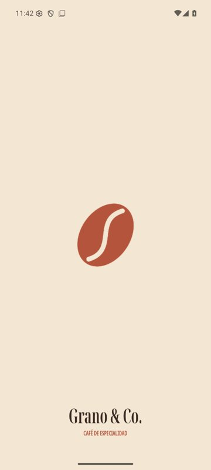
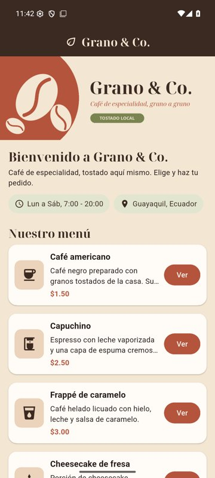
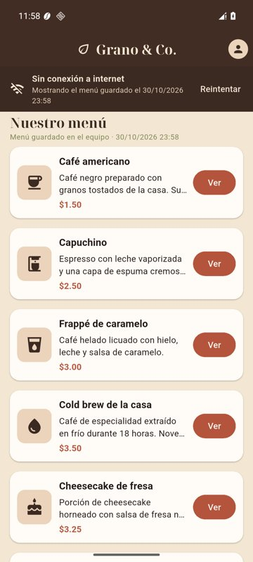
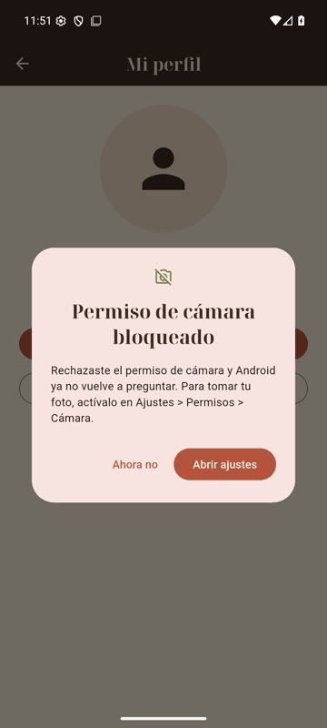
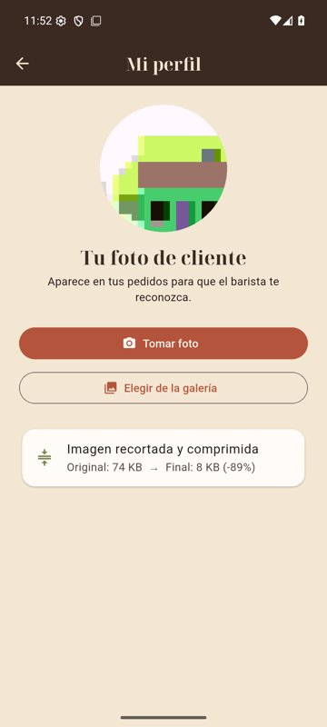
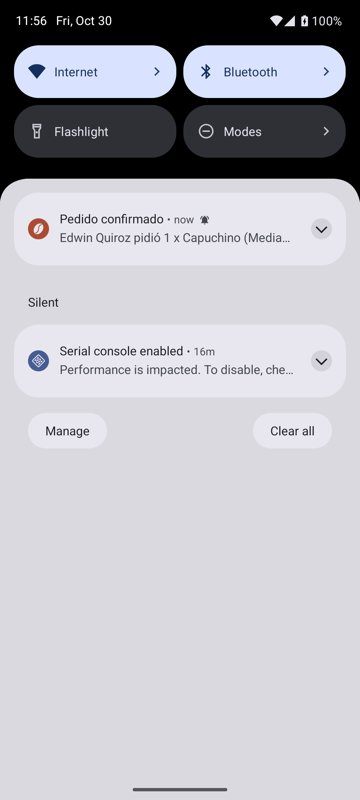
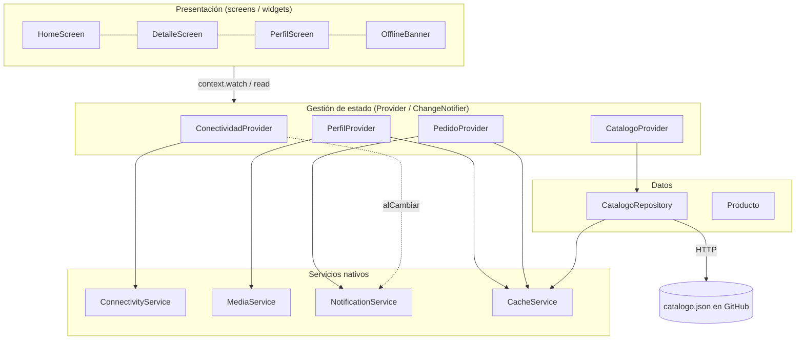

# Grano & Co. — Catálogo móvil de café de especialidad

Aplicación Flutter para el catálogo y los pedidos de una cafetería de especialidad.
Es la **versión 2.0**: reingeniería del prototipo *Café Aroma* (Actividad Integradora 1)
con rebranding completo y un módulo de servicios nativos.

Actividad Integradora 2 — Desarrollo de Aplicaciones Móviles · Universidad Ecotec

| Splash | Home | Sin conexión | Permiso bloqueado | Foto de perfil | Notificación |
|---|---|---|---|---|---|
|  |  |  |  |  |  |

## Novedades de la versión 2.0

### Rebranding

| | Antes (v1.0) | Ahora (v2.0) |
|---|---|---|
| Nombre comercial | Café Aroma (`cafeteria_app`) | **Grano & Co.** |
| Package name / Bundle ID | `com.edwinquiroz.cafeteria_app` | `com.edwinquiroz.granoco` |
| Ícono | Ícono por defecto de Flutter | Grano de café crema sobre terracota (adaptativo) |
| Splash screen | Pantalla blanca por defecto | Splash nativo crema con logo y wordmark (incluye Android 12+) |
| Paleta | Generada desde `Colors.brown` | Terracota `#B5543C`, espresso `#3B2A22`, crema `#F3E6D3`, oliva `#7A8450` |
| Tipografía | Roboto | Títulos en serif de marca (Noto Serif Display) |

### Servicios nativos

- **Conectividad en tiempo real:** `connectivity_plus` emite los cambios de red y se
  verifica la salida real a internet con una consulta DNS. Sin internet aparece un
  **banner offline** y la app usa el **menú guardado en caché** (`shared_preferences`).
  Al reconectar, el catálogo se vuelve a descargar automáticamente.
- **Cámara y galería con permisos dinámicos:** `permission_handler` cubre los casos
  concedido, denegado y **denegado permanentemente**; en el último ofrece abrir los
  Ajustes. La foto se **recorta** en círculo (`image_cropper`) y se **comprime**
  (`flutter_image_compress`, JPEG 70 %, 600 px).
- **Notificaciones locales:** `flutter_local_notifications` con dos **canales de Android**
  (*Pedidos*, importancia alta; *Estado de conexión*, normal) y soporte para iOS.
  Se notifica al confirmar un pedido, al perder la conexión y al recuperarla.

## Arquitectura

Arquitectura por capas con **Provider** como gestor de estado. La interfaz nunca llama
a los plugins: solo lee providers, y los providers usan servicios que se inyectan
desde `main.dart` (en las pruebas se reemplazan por servicios falsos).



### Estructura de carpetas

```
lib/
├── main.dart                      # Inyección de servicios y MultiProvider
├── core/
│   ├── theme/app_theme.dart       # Paleta y tema únicos de la marca
│   └── utils/formato.dart         # Formato de fechas y tamaños
├── models/producto.dart           # Modelo serializable (fromJson / toJson)
├── data/catalogo_repository.dart  # Red -> caché -> menú básico
├── services/                      # Servicios nativos (sin código de interfaz)
│   ├── connectivity_service.dart
│   ├── media_service.dart
│   ├── notification_service.dart
│   └── cache_service.dart
├── providers/                     # Estado de la app (ChangeNotifier)
│   ├── conectividad_provider.dart
│   ├── catalogo_provider.dart
│   ├── pedido_provider.dart
│   └── perfil_provider.dart
├── screens/                       # Home, Detalle y Mi perfil
└── widgets/                       # ProductoCard, InfoChip, OfflineBanner
```

## Requisitos

- Flutter 3.47.8 (canal stable) y Dart 3.13.7
- Android SDK con la plataforma **API 37** instalada (la exige `permission_handler` 13)
- Para iOS: Xcode y CocoaPods (macOS)

## Instalación y ejecución

```bash
git clone https://github.com/EDWJOSH/cafeteria_app.git
cd cafeteria_app
git checkout main                 # versión estable (develop = integración)
flutter pub get
flutter run                       # con un emulador o un dispositivo conectado
```

Si se modifican los assets de marca, se regeneran así:

```bash
dart run flutter_launcher_icons          # ícono de la app
dart run flutter_native_splash:create    # splash screen
```

### Cómo probar los servicios nativos

| Servicio | Prueba manual |
|---|---|
| Conectividad | Desactivar Wi-Fi y datos: aparece el banner y el menú guardado. Al reactivarlos el menú se recarga. En el emulador: `adb shell svc wifi disable` / `enable`. |
| Cámara | Mi perfil → *Tomar foto*. Rechazar el permiso dos veces muestra el diálogo para abrir los Ajustes. |
| Notificaciones | Confirmar un pedido o cortar la red. Los canales se ven en Ajustes → Apps → Grano & Co. → Notificaciones. |

## Permisos

| Permiso | Plataforma | Uso |
|---|---|---|
| `INTERNET`, `ACCESS_NETWORK_STATE` | Android | Descargar el catálogo y detectar la red |
| `CAMERA` / `NSCameraUsageDescription` | Android / iOS | Foto de perfil |
| `NSPhotoLibraryUsageDescription` | iOS | Elegir foto de la galería (Android 13+ usa el selector del sistema, sin permiso) |
| `POST_NOTIFICATIONS` | Android 13+ | Notificaciones locales |

## Pruebas

```bash
flutter analyze
flutter test
```

Hay 8 pruebas de widget con servicios falsos que cubren: menú descargado de la red, modo
offline, pérdida y recuperación de la conexión, navegación con paso de parámetros,
permiso de cámara denegado y bloqueado, y las notificaciones de pedidos y de conexión.

## Flujo de ramas

| Rama | Propósito |
|---|---|
| `main` | Versión estable publicada (v2.0 con rebranding) |
| `develop` | Integración de las funcionalidades |
| `feature/rebranding` | Nombre, identificador, ícono, splash y paleta |
| `feature/conectividad` | Detección de red, caché y banner offline |
| `feature/camara-permisos` | Cámara, galería, permisos, recorte y compresión |
| `feature/notificaciones` | Canales y notificaciones locales |

Cada `feature/*` se integra en `develop` con `merge --no-ff`, y `develop` se integra en `main`
al cerrar la versión.

## Autor

Edwin Quiroz — Desarrollo de Aplicaciones Móviles
