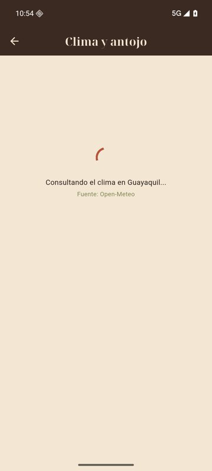
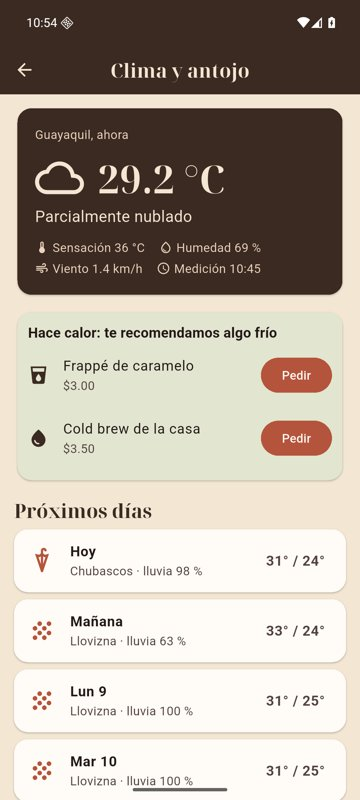
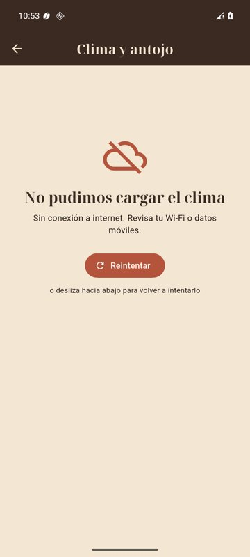
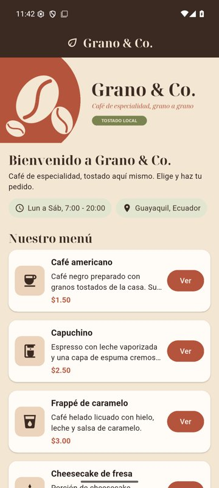
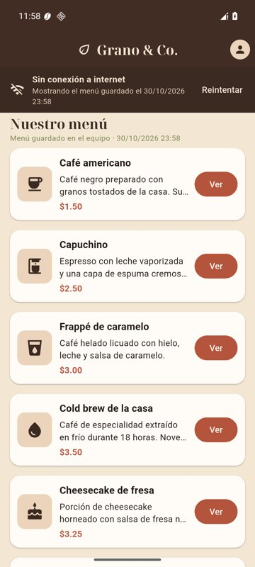
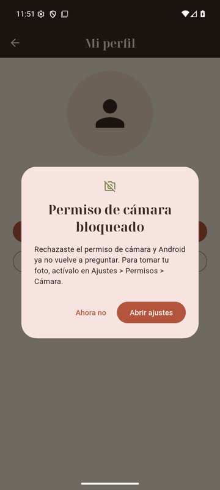
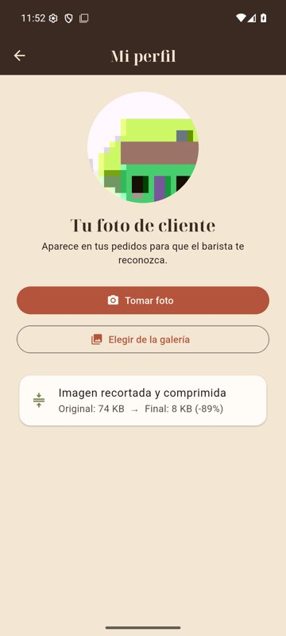
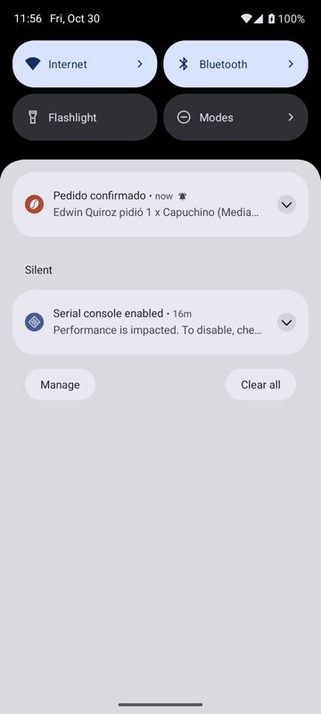
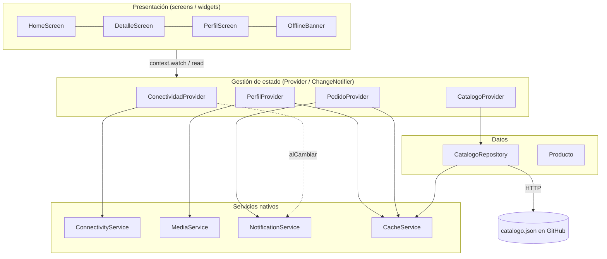

# Grano & Co. — Catálogo móvil de café de especialidad

Aplicación Flutter para el catálogo y los pedidos de una cafetería de especialidad.
Es la **versión 2.1**: reingeniería del prototipo *Café Aroma* (Actividad Integradora 1),
con rebranding y servicios nativos (Actividad Integradora 2) y consumo de una API REST
pública (Actividad Integradora 3).

Desarrollo de Aplicaciones Móviles · Universidad Ecotec

📄 **Informes técnicos:** [Actividad 2](docs/Quiroz_Edwin_ActividadIntegradora2.pdf) ·
[Actividad 3](docs/Quiroz_Edwin_ActividadIntegradora3.pdf)

## Novedad de la versión 2.1: API pública del clima

La pantalla **Clima y antojo** consume la API REST pública y gratuita de
[Open-Meteo](https://open-meteo.com/) (no requiere registro ni token). Muestra el clima
actual y el pronóstico de 5 días de Guayaquil y, según la temperatura, recomienda bebidas
frías (desde 26 °C) o calientes del menú.

| Cargando | Datos cargados | Error de red |
|---|---|---|
|  |  |  |

**Endpoint consumido (GET):**

```
https://api.open-meteo.com/v1/forecast?latitude=-2.19&longitude=-79.89
  &current=temperature_2m,apparent_temperature,relative_humidity_2m,weather_code,wind_speed_10m
  &daily=weather_code,temperature_2m_max,temperature_2m_min,precipitation_probability_max
  &timezone=America/Guayaquil&forecast_days=5
```

**Estructura del JSON (recortada):**

```json
{
  "timezone": "America/Guayaquil",
  "current": {
    "time": "2026-11-07T10:45", "temperature_2m": 29.2, "apparent_temperature": 36.0,
    "relative_humidity_2m": 69, "weather_code": 1, "wind_speed_10m": 1.4
  },
  "daily": {
    "time": ["2026-11-07", "2026-11-08"],
    "weather_code": [80, 53],
    "temperature_2m_max": [30.9, 32.9],
    "temperature_2m_min": [24.1, 24.2],
    "precipitation_probability_max": [98, 63]
  }
}
```

| Capa | Archivo | Responsabilidad |
|---|---|---|
| Servicio | `lib/services/clima_api_service.dart` | GET con `http`, límite de 10 s y errores convertidos en `ClimaException` |
| Modelo | `lib/models/clima.dart` | `Clima`, `ClimaActual` y `PronosticoDia` con `fromJson` / `toJson` |
| Estado | `lib/providers/clima_provider.dart` | Provider con los estados `cargando`, `exito` y `error` |
| Interfaz | `lib/screens/clima_screen.dart` | Tarjetas, recomendación, pull-to-refresh y botón *Reintentar* |

Para verla: Home → tarjeta **Clima y antojo**. Para actualizar, deslizar hacia abajo.
Datos del clima: Open-Meteo.com, licencia CC BY 4.0.

| Splash | Home | Sin conexión | Permiso bloqueado | Foto de perfil | Notificación |
|---|---|---|---|---|---|
|  |  |  |  |  |  |

## Versión 2.0: rebranding y servicios nativos

### Rebranding

| | Antes (v1.0) | Ahora (v2.0) |
|---|---|---|
| Nombre comercial | Café Aroma (`cafeteria_app`) | **Grano & Co.** |
| Package name / Bundle ID | `com.edwinquiroz.cafeteria_app` | `com.edwinquiroz.granoco` |
| Ícono | Ícono por defecto de Flutter | Grano de café crema sobre terracota (adaptativo) |
| Splash screen | Pantalla blanca por defecto | Splash nativo crema con logo y wordmark (incluye Android 12+) |
| Paleta | Generada desde `Colors.brown` | Terracota `#B5543C`, espresso `#3B2A22`, crema `#F3E6D3`, oliva `#7A8450` |
| Tipografía | Roboto | Títulos en serif de marca (Noto Serif Display) |

### Servicios nativos

- **Conectividad en tiempo real:** `connectivity_plus` emite los cambios de red y se
  verifica la salida real a internet con una consulta DNS. Sin internet aparece un
  **banner offline** y la app usa el **menú guardado en caché** (`shared_preferences`).
  Al reconectar, el catálogo se vuelve a descargar automáticamente.
- **Cámara y galería con permisos dinámicos:** `permission_handler` cubre los casos
  concedido, denegado y **denegado permanentemente**; en el último ofrece abrir los
  Ajustes. La foto se **recorta** en círculo (`image_cropper`) y se **comprime**
  (`flutter_image_compress`, JPEG 70 %, 600 px).
- **Notificaciones locales:** `flutter_local_notifications` con dos **canales de Android**
  (*Pedidos*, importancia alta; *Estado de conexión*, normal) y soporte para iOS.
  Se notifica al confirmar un pedido, al perder la conexión y al recuperarla.

## Arquitectura

Arquitectura por capas con **Provider** como gestor de estado. La interfaz nunca llama
a los plugins: solo lee providers, y los providers usan servicios que se inyectan
desde `main.dart` (en las pruebas se reemplazan por servicios falsos).



### Estructura de carpetas

```
lib/
├── main.dart                      # Inyección de servicios y MultiProvider
├── core/
│   ├── theme/app_theme.dart       # Paleta y tema únicos de la marca
│   └── utils/formato.dart         # Formato de fechas y tamaños
├── models/                        # Producto y Clima (fromJson / toJson)
├── data/catalogo_repository.dart  # Red -> caché -> menú básico
├── services/                      # Servicios nativos (sin código de interfaz)
│   ├── clima_api_service.dart     # API REST de Open-Meteo
│   ├── connectivity_service.dart
│   ├── media_service.dart
│   ├── notification_service.dart
│   └── cache_service.dart
├── providers/                     # Estado de la app (ChangeNotifier)
│   ├── clima_provider.dart
│   ├── conectividad_provider.dart
│   ├── catalogo_provider.dart
│   ├── pedido_provider.dart
│   └── perfil_provider.dart
├── screens/                       # Home, Detalle, Mi perfil y Clima y antojo
└── widgets/                       # ProductoCard, InfoChip, OfflineBanner
```

## Requisitos

- Flutter 3.47.8 (canal stable) y Dart 3.13.7
- Android SDK con la plataforma **API 37** instalada (la exige `permission_handler` 13)
- Para iOS: Xcode y CocoaPods (macOS)

## Instalación y ejecución

```bash
git clone https://github.com/EDWJOSH/cafeteria_app.git
cd cafeteria_app
git checkout main                 # versión estable (develop = integración)
flutter pub get
flutter run                       # con un emulador o un dispositivo conectado
```

Si se modifican los assets de marca, se regeneran así:

```bash
dart run flutter_launcher_icons          # ícono de la app
dart run flutter_native_splash:create    # splash screen
```

### Cómo probar los servicios nativos

| Servicio | Prueba manual |
|---|---|
| Conectividad | Desactivar Wi-Fi y datos: aparece el banner y el menú guardado. Al reactivarlos el menú se recarga. En el emulador: `adb shell svc wifi disable` / `enable`. |
| Cámara | Mi perfil → *Tomar foto*. Rechazar el permiso dos veces muestra el diálogo para abrir los Ajustes. |
| Notificaciones | Confirmar un pedido o cortar la red. Los canales se ven en Ajustes → Apps → Grano & Co. → Notificaciones. |

## Permisos

| Permiso | Plataforma | Uso |
|---|---|---|
| `INTERNET`, `ACCESS_NETWORK_STATE` | Android | Descargar el catálogo y detectar la red |
| `CAMERA` / `NSCameraUsageDescription` | Android / iOS | Foto de perfil |
| `NSPhotoLibraryUsageDescription` | iOS | Elegir foto de la galería (Android 13+ usa el selector del sistema, sin permiso) |
| `POST_NOTIFICATIONS` | Android 13+ | Notificaciones locales |

## Pruebas

```bash
flutter analyze
flutter test
```

Hay 15 pruebas con servicios falsos. Cubren el menú descargado de la red, el modo
offline, la pérdida y recuperación de la conexión, la navegación con paso de parámetros,
el permiso de cámara denegado y bloqueado, y las notificaciones de pedidos y de conexión.
Para la API del clima cubren el mapeo `fromJson` / `toJson`, los errores HTTP, de red y de JSON,
y los estados Cargando → Éxito y Error → Reintentar.

## Flujo de ramas

| Rama | Propósito |
|---|---|
| `main` | Versión estable publicada |
| `develop` | Integración de las funcionalidades |
| `feature/rebranding` | Nombre, identificador, ícono, splash y paleta |
| `feature/conectividad` | Detección de red, caché y banner offline |
| `feature/camara-permisos` | Cámara, galería, permisos, recorte y compresión |
| `feature/notificaciones` | Canales y notificaciones locales |
| `feature/api-integration` | Consumo de la API de Open-Meteo y pantalla Clima y antojo |

Cada `feature/*` se integra en `develop` con `merge --no-ff`, y `develop` se integra en `main`
al cerrar la versión.

## Autor

Edwin Quiroz — Desarrollo de Aplicaciones Móviles
